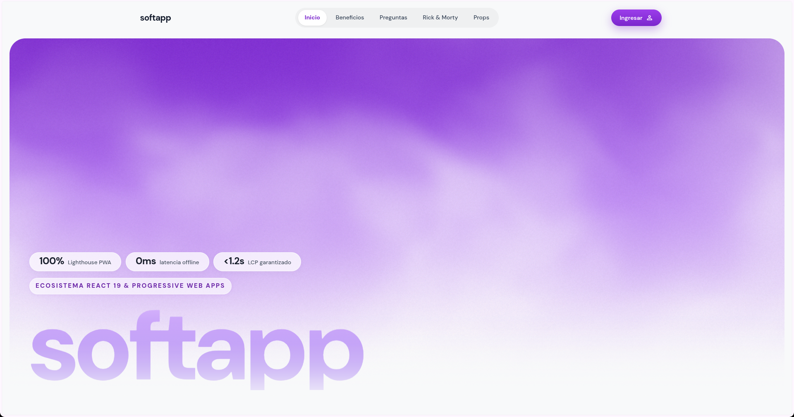
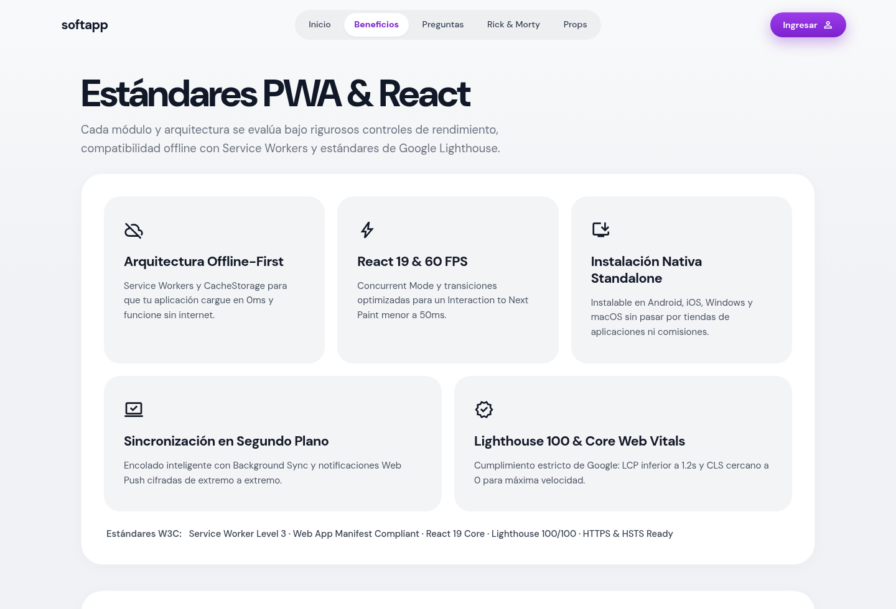
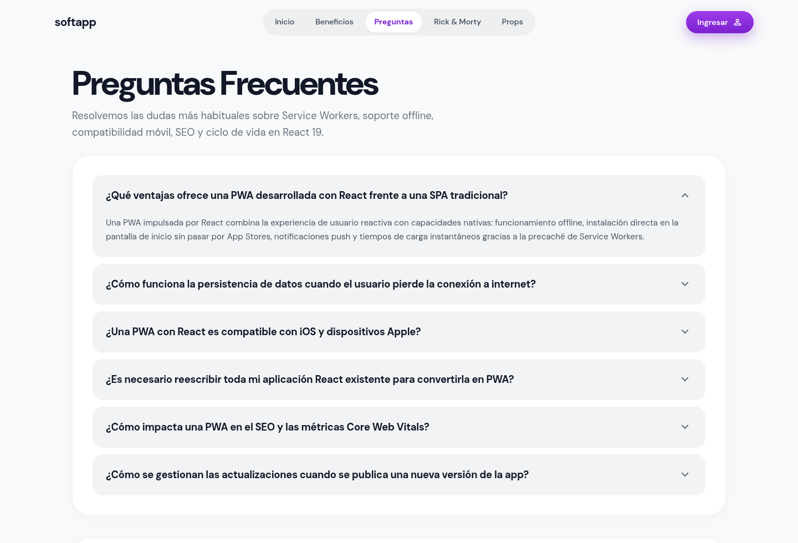
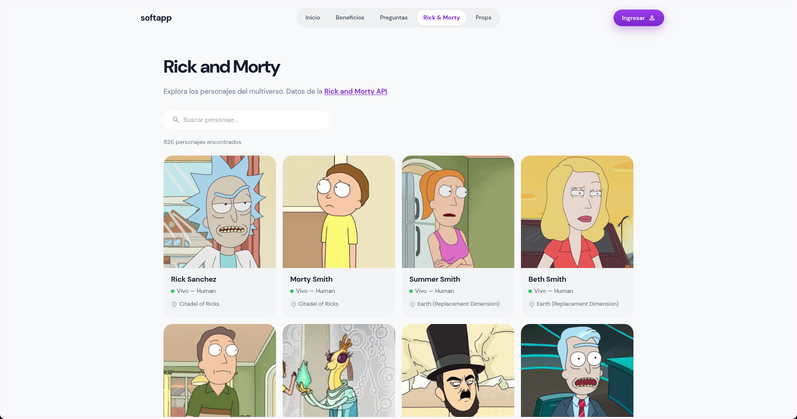
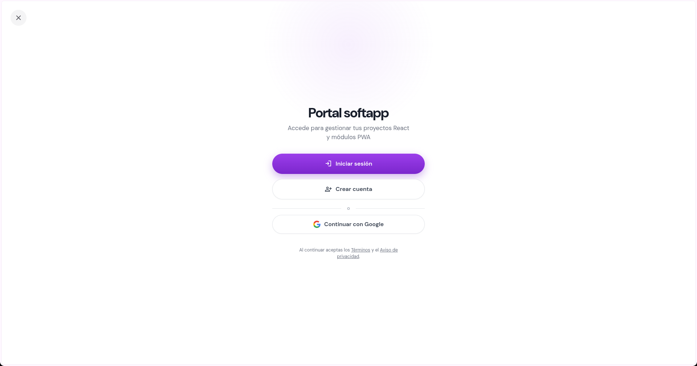
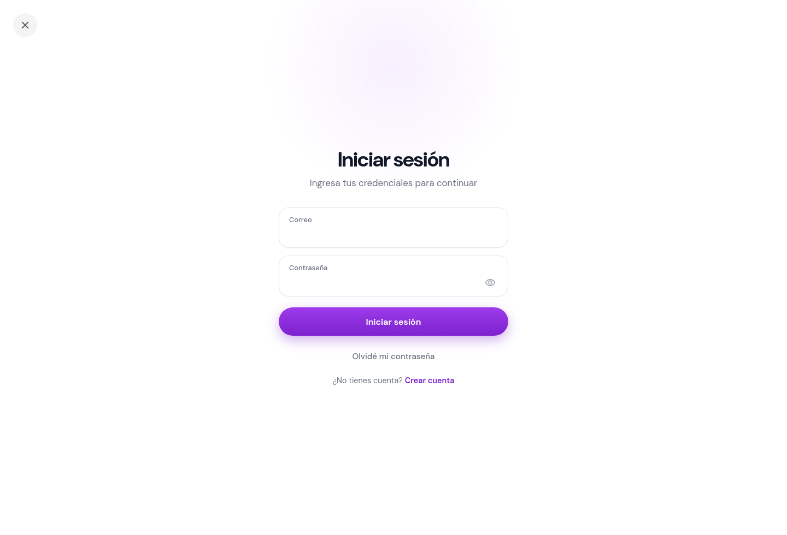
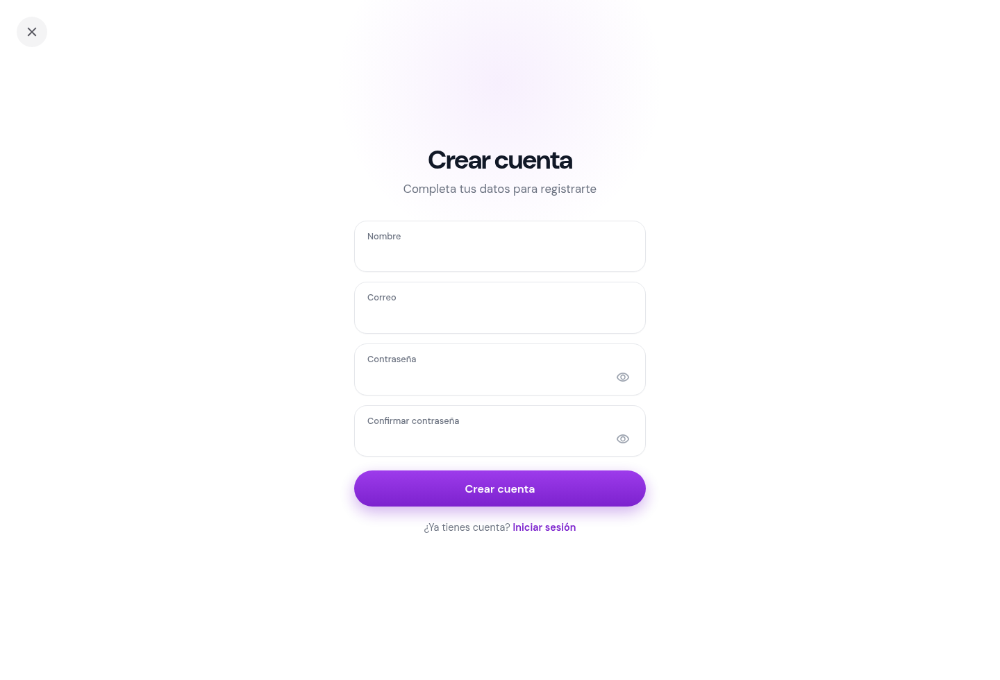
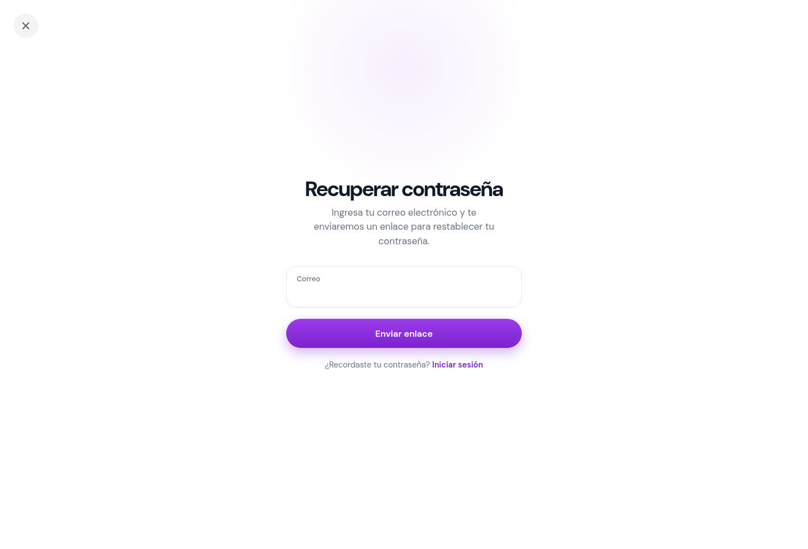

# Softapp 🌟

Softapp es una aplicación web construida con React para presentar conceptos y beneficios de las Progressive Web Apps (PWA). Combina páginas informativas con ejemplos interactivos de componentes, consumo de una API y formularios de acceso. El proyecto incluye navegación por rutas, diseño adaptable, animaciones y configuración para instalarse como PWA.

- **Sitio publicado:** [joanstvn.github.io/reactapp](https://joanstvn.github.io/reactapp/)
- **Repositorio:** [github.com/joanstvn/reactapp](https://github.com/joanstvn/reactapp)

## ✨ Características principales

- **Páginas informativas:** inicio, beneficios de las PWA y preguntas frecuentes.
- **Demostraciones de React:** paso de propiedades a componentes y catálogo de personajes de Rick and Morty.
- **Portal de usuario:** pantallas de inicio de sesión, registro y recuperación de contraseña.
- **Diseño adaptable:** navegación e interfaces pensadas para escritorio y dispositivos móviles.
- **Animaciones y desplazamiento suave:** GSAP, ScrollTrigger y Lenis.
- **PWA:** manifiesto, iconos instalables y estrategias de caché con `vite-plugin-pwa` y Workbox.
- **Imágenes de Props:** alojadas en Imgur y referenciadas desde la interfaz, sin copias locales.

> Los formularios de acceso son interfaces de demostración. No hay un backend ni un proveedor de autenticación conectado.

## 🖥️ Interfaz gráfica

Las siguientes capturas muestran las vistas principales de Softapp.

### Inicio



### Beneficios y preguntas frecuentes

<p align="center">
  
  
</p>

### Catálogo y portal de usuario

<p align="center">
  
  
</p>

### Acceso, registro y recuperación

<p align="center">
  
  
  
</p>

## 🏗️ Arquitectura del Proyecto

El código se organiza por funcionalidades. `landing` contiene las páginas públicas y componentes compartidos; `auth` reúne las pantallas de acceso. `App.jsx` declara las rutas con carga diferida y `MainLayout` comparte la navegación y el pie de página de las páginas informativas.

```text
.
├── .github/
│   └── workflows/
│       └── deploy-pages.yml
├── docs/
│   └── screenshots/
├── public/
│   ├── pwa-192x192.png
│   ├── pwa-512x512.png
│   └── softapp-icon.png
├── scripts/
│   └── create-pages-routes.mjs
├── src/
│   ├── App.jsx
│   ├── main.jsx
│   ├── index.css
│   └── features/
│       ├── auth/
│       │   └── components/
│       │       ├── AuthChoice.jsx
│       │       ├── LoginForm.jsx
│       │       ├── RegisterForm.jsx
│       │       └── RecoverPassword.jsx
│       └── landing/
│           ├── components/
│           ├── layouts/
│           └── pages/
├── index.html
├── vite.config.js
└── package.json
```

### Rutas

| Ruta | Contenido |
| --- | --- |
| `/` | Inicio |
| `/beneficios` | Beneficios y características PWA |
| `/faq` | Preguntas frecuentes |
| `/rick-and-morty` | Catálogo con datos de Rick and Morty API |
| `/props` | Demostración de propiedades e imágenes alojadas en Imgur |
| `/login` | Opciones de acceso y registro |
| `/login/iniciar-sesion` | Formulario de inicio de sesión |
| `/login/crear-cuenta` | Formulario de registro |
| `/login/recuperar` | Recuperación de contraseña |

## 🛠️ Tecnologías

- **Interfaz:** React 19 y React DOM
- **Rutas:** React Router 7
- **Desarrollo y compilación:** Vite 8
- **PWA y caché:** `vite-plugin-pwa` y Workbox
- **Animaciones y scroll:** GSAP, ScrollTrigger y Lenis
- **Análisis estático:** Oxlint
- **Datos externos:** Rick and Morty API; imágenes de Props alojadas en Imgur

## 📦 Instalación y uso

Necesitas Node.js compatible con la versión de Vite del proyecto y npm.

```bash
git clone https://github.com/joanstvn/reactapp.git
cd reactapp
npm install
npm run dev
```

Vite mostrará en la terminal la dirección local para abrir la aplicación.

### Comandos disponibles

```bash
npm run dev      # Inicia el servidor de desarrollo
npm run build    # Genera la compilación de producción en dist/
npm run preview  # Previsualiza la compilación
npm run lint     # Analiza el código con Oxlint
```

La publicación en GitHub Pages utiliza la configuración de Vite para el subdirectorio `/reactapp/` y el flujo de trabajo definido en `.github/workflows/deploy-pages.yml`.

## 👤 Datos importantes del Autor

- **GitHub:** [@joanstvn](https://github.com/joanstvn)
- **Repositorio del proyecto:** [joanstvn/reactapp](https://github.com/joanstvn/reactapp)
- **Sitio web:** [Softapp en GitHub Pages](https://joanstvn.github.io/reactapp/)

## 📄 Licencia

Este repositorio no especifica una licencia actualmente.
